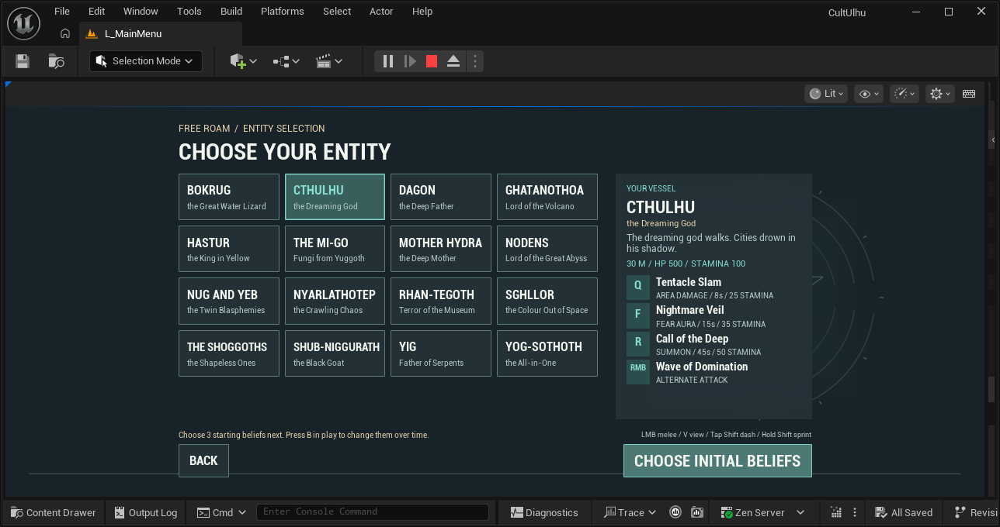

# Character selection readability

The previous menu gave most of its width to long entity names and repeated
flavor text. Original kit information was compressed into one narrow paragraph.
The revised menu separates each entity's short name and epithet, keeps flavor
on the selected detail panel, and gives Q, F, R and RMB distinct rows. Existing
fonts and the dark teal/bone/gold theme are retained; no external artwork or
font is downloaded.

A fitted 1280 x 720 reference canvas preserves the roster/detail proportions
under the existing engine DPI curve. All sixteen released entities remain in
four columns. Long names scale down within their card instead of extending
into another button. The complete original name and flavor remain in tooltips.
Selection retains the original card callback and selected-entity persistence.

The detail panel reads the original definition once per selection and displays
the original spell names, cooldowns and stamina costs. It describes existing
mode behavior: competitive hero-only healing, Domination's invocation strike,
competitive normalized health, and Cthulhu's MOBA Minion Sling with its actual
20-second cooldown. This pass does not modify those abilities or their values.
Free Roam explains choosing three initial beliefs and pressing B to change
beliefs over time. Competitive modes show their own guidance. That guidance
and the movement hints sit in a fixed footer above the action buttons.

## Verification

The canonical project validator passes and CultUlhuEditor Win64 Development
compiles on UE 5.8.3 in 19.45 seconds. The final fresh native run has three
successes and no automation errors: CharacterSelectionCapture,
CharacterSelectionLayout and Select. CharacterSelectionResults.json records
the exact log hashes, rejected iterations, input checks and image hashes.

The layout check renders real UMG/Slate at 960 x 540, 1280 x 720,
1920 x 1080 and 1280 x 540 using the real engine DPI curve in each of the three
modes. It broadcasts all sixteen actual card OnClicked delegates in every case:
192 selections, 576 original Q/F/R rows and 192 alternate rows. Assertions check
complete card visibility, measured name glyph bounds, action-row separation,
four visible ability name/metadata rows, source cooldown/cost values, mode
adaptations, normalized health and mode-specific belief guidance. Minimum
entity-name glyph heights are 18/23/35/18 pixels across the four tested sizes.
These are measured font bounds, not an accessibility certification.

The first green capture/flow run was rejected visually because long names
overlapped and the last row was hidden. A later green layout run still allowed
the belief instruction to slip below the scroll viewport; moving it to a fixed
footer then exposed two 720p metadata clips. The final revision retains the
visibility assertions and tightens detail spacing. Those failed or inadequate
iterations are preserved in the results, not counted as final acceptance.

All 425 backed-up Content files remain byte-identical to d59b415. All sixteen
released original character.def files match that checkpoint after line-ending
normalization. No gameplay implementation, asset or source kit is replaced.
RenderCore is added only to Editor dependencies for the native capture fixture.
The isolated test process disables the MCP transport by command line to avoid
its previously observed resource-discovery error; normal project MCP settings
are unchanged.

## Images and limits

The matched controlled renders below use identical FWidgetRenderer settings
before and after. Their offscreen readback is lighter than the real editor
viewport, so they establish layout changes, not final palette or contrast.
The separate editor screenshot is the actual dark palette reference. Images
are raw native outputs, copied without resizing or recoloring; five images
total 616,808 bytes.

| View | Previous | Revised |
| --- | --- | --- |
| 1280 x 720 layout | [Before](Images/CharacterSelectionBefore1280.png) | [After](Images/CharacterSelectionAfter1280.png) |
| 960 x 540 layout | [Before](Images/CharacterSelectionBefore960.png) | [After](Images/CharacterSelectionAfter960.png) |

The delegate test does not prove physical mouse/controller navigation. Four
resolutions do not prove arbitrary windows, portrait layouts, localization,
screen readers or controller focus. The menu remains text-led: no authored hero
portrait, animated preview, role-composition presentation or final motion design
has been delivered. Small-screen secondary hints remain small. Actual match
feel, balance, low-spec frame rate, multiplayer and a fresh standalone package
are not established by this menu run. The broader production goal remains open.
