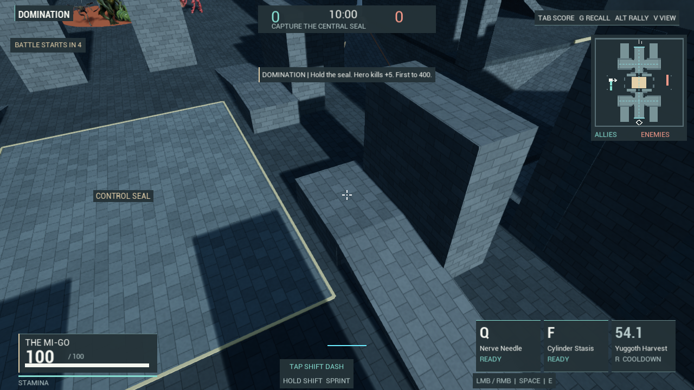
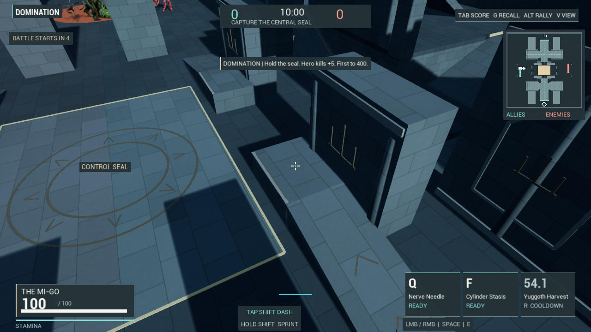

# Domination: readable stone and original architectural relief

The previous arena used similar small masonry patterns across floors, walls and ramps. Repeated joints competed with targets and made the oversized structures read as stretched blocks. The lower firing platforms also had an unsupported gap underneath them.

## Changes

- A new, separate `M_DominationStone_v1` material supplies broader floor slabs and wall courses, quieter mortar, restrained grain, weather/runoff variation and distinct cut-stone/bronze finishes. It uses no downloaded textures. The original `M_MatchStone` asset is preserved; MOBA retains that material.
- Closed carved wall panels, Crown/Hollow crests, crypt-header ribs, perch edges and ramp inlays give the existing structures a more coherent identity. The central non-emissive seal remains inside the unchanged rectangular capture border.
- The relief is one merged component with three material sections and 5,568 triangles. It has no collision and replaces the visible older keep skins. The actual crypt openings remain open; panels on solid walls are closed relief, not pretend entrances.
- Firing-perch bases now extend to the ground. Their tops remain at 9m and their ramps retain their positions. The formerly empty space below these small platforms now has matching visible stone and solid collision. This is a bounded physical change, separate from the cosmetic finish.

Imported character art and authored kits are unchanged. Existing approved-model attribution remains in [CREDITS.md](../Content/CharacterModels/CREDITS.md).

## Same-world comparison

Both frames below use the same frozen world, player, camera and lighting configuration. Both include the final grounded pedestals. The switch changes materials and architectural relief visibility; it does not rewind the previous map's collision. Shadows can differ where the visible facade changes.





The native comparison also exports spawn, crypt and overview pairs at 1280×720. It verifies actor counts, player transform/height, static meshes, procedural vertices/indices, transforms, component visibility and collision through the switch. The new material must have a compiled shader map without compile errors; accepting the default fallback is insufficient.

## Verification and reproduction

Build the canonical `CultUlhuEditor Win64 Development` target after running `Tools/ValidateCultUlhu.py`. Then run:

```text
Automation RunTests CultUlhu.Menu.DominationFinish
Automation RunTests CultUlhu.Menu.DominationArchitecture
Automation RunTests CultUlhu.Menu.DominationUpperCombat
Automation RunTests CultUlhu.Menu.DominationMatch
Automation RunTests CultUlhu.Menu.CombatTactics
Automation RunTests CultUlhu.Menu.MatchSurfaces.Moba
```

`DominationFinish` freezes its dedicated test world to compare appearance and collect four A-B-B-A render windows. This is a test fixture; ordinary competitive menus continue to leave the match running. `DominationArchitecture` and `DominationUpperCombat` exercise the real ramps, upper/covered routes, original projectile contact and independent bot movement with the final geometry. The full-match and MOBA checks cover their respective existing behavior.

Run `Tools/AnalyzeDominationFinish.py` with Unreal's bundled Python to summarize the native CSVs. The script resolves the canonical project from its own file, excludes footer rows, requires explicit scene/state counters and distinguishes counts from timings. The measured combined finish GPU means were 4.686ms legacy and 4.635ms refined, across two 120-frame windows per state. This small difference does not establish a performance gain. The sample is one local frozen editor view; the exact-size exported PNGs do not establish the profiling backbuffer resolution, live-match FPS or low-spec performance.

`Tools/BuildDominationStone.py` creates a fresh versioned asset and refuses to overwrite an existing one. It records the original material hash and the new shader/asset hashes in `Saved/Reports/DominationStoneBuild.json`. Use a new version for later art changes. The default presentation is selected at match creation; `cult.Domination.Refinement=0` before creating the level selects the previous finish. The editor-only comparison utility applies both states explicitly.

Detailed final-build checks, source hashes and network evidence are recorded in `DominationFinishVerification_2026-10-31.json`. Raw captures, CSVs, logs and the build receipt remain under `Saved/`; only the selected proof pair is included here.

## Critical limits

The renders are cleaner, but large rectangular masses, sparse exterior composition and repetitive constructed shapes remain. These are original procedural refinements, not finished artist-directed architecture. Human matchup/enjoyment review, more character/material contrast checks, animation quality, HUD density and low-spec/two-PC testing remain open. This pass does not establish Overwatch-level presentation or Onslaught-level fun.
