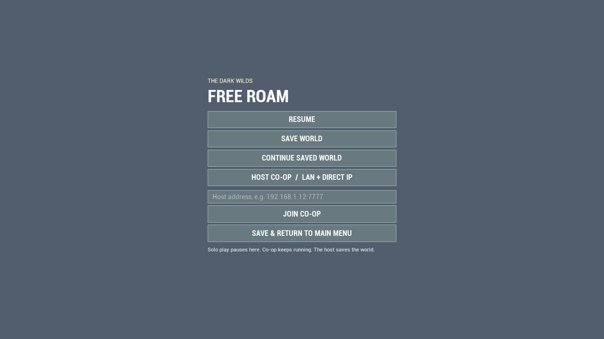

# Free Roam: saves, menu and co-op

## Playing and keeping progress

1. Press Play. Choose **Free Roam**, then **New World** to choose your character and three beliefs.
2. Press **Esc** during Free Roam to open its menu. Solo play pauses; Esc or **Resume** returns to the same world.
3. **Save World** saves your current world. An autosave also runs every 60 seconds of unpaused play.
4. Use **Save & Return to Main Menu** when leaving. A failed save keeps you in the menu and explains the error.
5. Next time, choose **Free Roam → Continue Saved World**. This also reloads your latest save from the pause menu; progress since that save is replaced.

Saves include the terrain/decor seed, character and position, health/stamina/cooldowns, live population and allegiance, loyalty, captives, orders, battle assignments, rival entities, damaged/destroyed buildings, city registry, faction power, beliefs and adoption timers, exertion, wars, construction progress, rituals, traps, and captive work. Projectiles, temporary hit flashes and short-lived corpses are transient.

The save is local to this computer at `Saved/SaveGames/FreeRoam.sav` inside the canonical project. `FreeRoam.sav.bak` retains the previous valid save. Writes use a temporary file, verify its bytes and preserve the backup before replacement. A damaged primary save falls back to the backup. Personal progress is not committed to GitHub. Closing the application through Windows can lose progress since the latest autosave; use the in-game exit for a final save.

## Hosting and joining

1. The host starts or continues a Free Roam world, opens **Esc**, and chooses **Host Co-op / LAN + Direct IP**. Hosting saves and reopens that world as a listen server.
2. Another player opens **Free Roam** from the main menu, or its Esc menu, enters the host's address, and chooses **Join Co-op**. Example: `192.168.1.12:7777`.
3. For the same PC, a second game process can join `127.0.0.1:7777`. For different PCs, use the host's LAN address, or the host's address on an existing VPN such as Radmin. Both computers need the same game build and assets.
4. If Windows asks, allow the game through the firewall on the network you intend to use. Internet connections outside a shared LAN/VPN require the host's network to route UDP port 7777. The game does not change router settings or provide internet matchmaking.
5. Players cooperate in the same cult. Rival cults remain controlled by the host's AI. The host owns world saving, belief changes and direct entity rites. Guests can inspect beliefs and issue cultist orders with ALT; guests use **Leave Co-op** to disconnect. Guests rejoin with their selected character near the host; their separate position and health are not stored as personal accounts.

The co-op menu does not pause everyone else. Save/load is a host responsibility; loading a different snapshot requires returning to the main menu and hosting again. Cultists belong to the shared cult, so players should coordinate army orders.

## Other changes

- Corpse lifetime: **2 seconds** in Domination and DOTGOO, **5 seconds** in Free Roam.
- Free Roam uses the same third-person boom length and shoulder offset as Domination; **V** still switches perspective.
- City and temple destructible buildings have **three times** their previous maximum health. Competitive objective progression and ward health use their separate match rules.

## Verification

`CultUlhu.FreeRoam.Persistence` tests a modified world through an in-place restore and a full menu/map reload, uses an isolated automation save slot, checks corrupt-save rejection and backup recovery, checks the camera/resistance settings, and waits for actual corpse destruction at both lifetimes.

`-CultCoopProbe=Host` and `-CultCoopProbe=Client` enable a development-only two-process test harness. It checks shared terrain and population/building replication, an authoritative melee kill from a guest, dash movement reaching the host, and host world saving. The listen-server bandwidth budget is configured for the populated world rather than the engine's default 7 KB/s dynamic cap. These flags are dormant in normal play and do not exist in shipping builds. Small proof files and test saves stay under `Saved/`; no imported assets or build output are added to source control.

## Verified build — 2026-10-31

The canonical engine-linked core passed 18/18 checks and the rebuilt headless core passed 109/109. Four native Unreal tests passed: Free Roam persistence, Domination camera framing, real menu callback/pause flow, and DOTGOO mechanics. Menu buttons fit both 960×540 and 1280×720.

The final saved-world test restored seven cities and checked real health loss, a used F ability, spent dash stamina, cooldowns, destroyed structures, captives, loyalty, active belief adoption and wars. It rejected corrupted input before modifying the live world and recovered the on-disk backup. Escape was injected through the actual player-controller input path.

A separate host and guest process connected through localhost, synchronized the world seed, buildings and people, and confirmed the guest's melee kill, dash movement, read-only shared faith controls, and a durable host save. Separate physical PCs, router traversal and internet latency were not tested. See [machine-readable results](FreeRoamVerification_2026-10-31.json).

