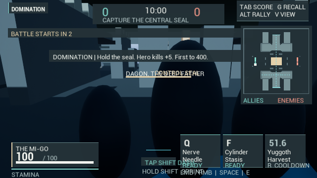
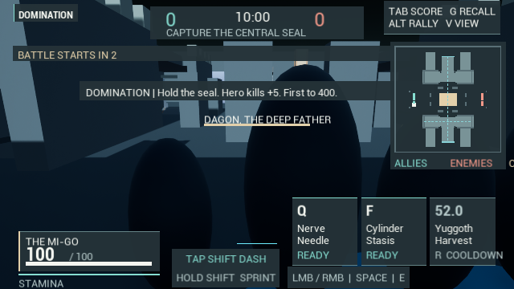

# Measured HUD readability

The suspected top-right hint clipping was investigated before changing metrics.
The actual Editor Canvas probe measures and draws the same 291 px string width,
retains the intended margin, and records runtime font caching/DPI 1. The observed
frame instead loses contrast against bright columns. No arbitrary alignment
offset was added as a fictitious font fix.

Mode/status and controls now have compact dark backing, restrained borders and a
stronger condensed mode title. Competitive hints use two lines when a single row
would enter the score panel. Footer bindings and movement instructions also keep
their contrast against bright effects. Original bindings and canonical ability
names remain the displayed content.

The first header-only matrix looked better, but visual review of 640x360 exposed
other failures: wrapped ability names entered status rows, and dash/sprint text
crossed into the first card. Minimum font sizes prevented simply scaling the old
fixed coordinates. Cards now reserve measured key/name/state heights with real
gaps and padding. Movement instructions fit the available gap between vitals and
abilities. RMB prompts/notices stack above the cards; ALT inspection reserves the
current combat area's upper edge instead of a fixed estimate.

## Evidence and capture correction

The canonical Editor builds succeed. An opt-in development probe records actual
Canvas glyph advances, measured dimensions, position, DPI, cache type and canvas
size. It stays disabled in ordinary gameplay and is absent in Shipping.

An independent PNG-header audit caught an insufficient initial capture method:
after the input/eject tests, larger logical canvases could be cropped to the
editor backbuffer (1280x680 or 1288x680). Passing Canvas-coordinate checks did not
prove full-size screenshots. The old dimensions/hashes are retained in the
results JSON rather than labeled successful large-frame visual evidence.

The corrected fixture uses the engine's dedicated capture render targets, retains
glyph samples from those exact draws, checks saved PNG dimensions inside the test,
and restores capture settings afterward. It removes stale images before capture.
This establishes exact-size offscreen HUD rendering; it does not simulate every
physical display/window/DPI combination or establish gameplay frame rate.

HUDContrastFinal.log passes all eight requested checks with zero automation
errors: ArmyHUDCoordinates, EditorInputSafety, HUDTextRendering,
MatchHUDCoordinates, MatchTextRendering, MobaLiftTextRendering,
MobaTextRendering and PopulationPresentation. The twelve final PNG dimensions
were also independently verified. The matrix covers 640x360, 1280x720 and 1920x720
for Mi-Go across Free Roam/Domination/MOBA and Cthulhu in MOBA. It checks actual
margins, mode/score separation, wrapped ability/status glyphs, movement cues and
the explicit native Cthulhu minion instruction. Normal constrained-view input,
ALT inspection and persistent corpse geometry retain their separate checks.

Selected small, normal, wide, Cthulhu and inspection frames were viewed. The
specific card collisions are corrected and hints remain readable against bright
architecture/effects. The before image below already includes the header pass;
it precedes measured card rows. These are separate live captures, not a
pixel-identical paused-scene comparison.

HUDReadabilityResults.json preserves observations, positions and image/log hashes.
This is scoped UI improvement, not Overwatch-level polish or human usability
proof. Long competitive announcements still overflow at small width; allied
name tags can overlap and placeholder vessels can heavily obscure the camera.
Those visible problems remain work. Runtime.HUDTextRendering is available for a
later independent executable, but these newer edits have not been recooked/run
there. No content download, model duplicate or standalone package was added.

Subsequent evidence in MatchEvents.md addresses competitive message wrapping,
elimination/objective separation and projected-label bounds in its tested matrix.
That follow-up does not resolve general crowd visibility or establish final art.
