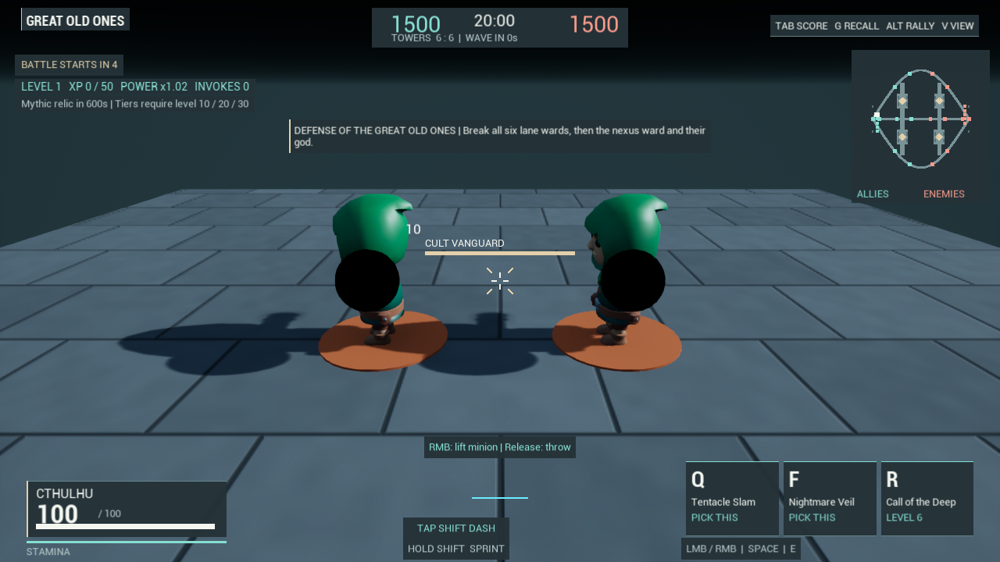
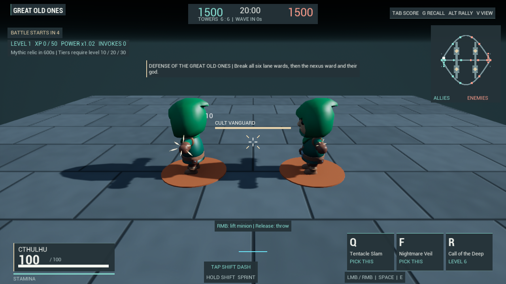
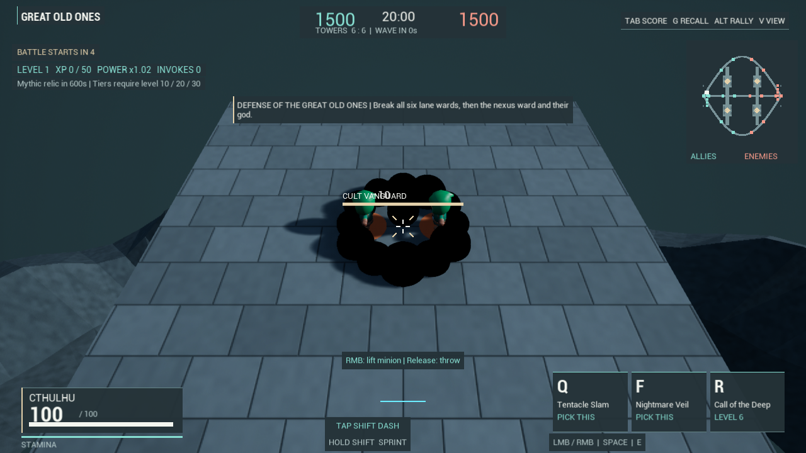
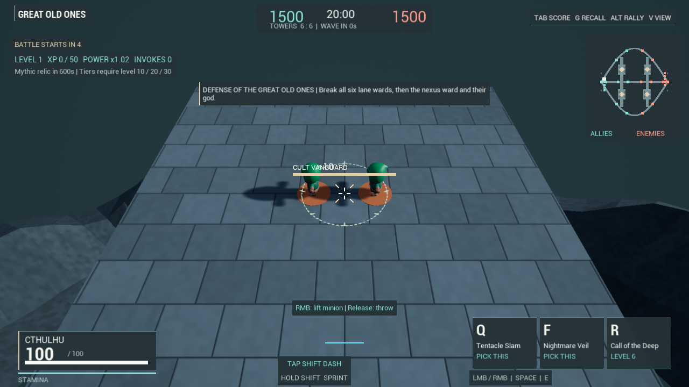

# Open impact feedback

The FX spawn path previously clamped every requested radius parameter to at
least 2 metres. Local hit feedback requested 0.3 m for a hit and 0.6 m for a kill,
so both were promoted to the same value before their spherical flash animation.
That erased the intended distinction and covered more of the target. Repeated
shock effects also created twelve round dust puffs plus one central flash.

Hit flashes now use six short, pointed streaks in an open arrangement aligned
across the source-to-contact direction. They preserve the requested 0.3/0.6 m
size distinction and fade over 180 milliseconds. World position remains the
actual contact passed to feedback. Existing hit sounds, damage numbers, hit/kill
confirmation, camera impulse, combat focus and damage handling are retained.
Sparks eject toward the incoming side of the contact, with at most 45 cm of
cosmetic relief. This helps them emerge from armor that overhangs a gameplay
capsule. Their depth testing remains enabled; the actor's recorded contact and
the damage/collision volumes do not move.

Shock effects now use a narrow expanding rim with eight separated rune strokes.
They fade over 550 milliseconds. Their original two-metre minimum radius
parameter is retained; only hit flashes accept the smaller feedback sizes.
This is an impact effect, not an attack warning or new damage volume. Attack
windups, hitboxes, projectile traces, damage, cooldowns and source abilities
retain their existing rules. Collapse DustBurst keeps its original nine puffs.

Each new hit or shock effect has one procedural mesh component, no collision
and no shadows. Hits use 48 triangles; shocks use 576. A stable topology allows
buffer updates as the effect animates. The existing M_AttackSignal material is
reused with independent dynamic instances. There are no downloaded assets,
new material/texture files or packaged builds. This reduces shock component
count from thirteen to one; it is not evidence of an overall FPS improvement.

`cult.FX.ImpactSignals 0` selects the legacy effect at spawn. Existing effects
keep their spawn-time choice. The comparison uses that switch in one paused
real MOBA world, two actual minor minions, matched contact points/camera views
and the same 40-millisecond effect sample. The left hit requests 0.3 m, and the
right requests 0.6 m. Dust puffs in the legacy shock use their original random
variation. These are controlled comparisons, not human battle playtests.

## Verification scope

ImpactPresentationResults.json records the accepted canonical Editor build and
native outcomes. The focused fixture reproduces the original parameter clamp,
checks actual generated scale and geometry, collision/shadow behavior, fade and
expiry, retained dust, unchanged target health, and the real RecordCombatHit
caller's contact/direction payload. Four exact 1280x720 renders compare hits
and shock effects. Separate physical combat and combat-feedback checks exercise
actual melee/projectile contacts, misses and evade behavior.

The direct RecordCombatHit probe tests feedback delivery; it does not prove a
new damage event. The separate combat checks cover damage paths. Passing these
fixtures does not establish human hit satisfaction, competitive balance or
complete battle readability. No new frame-time, memory, low-spec, multiplayer
or standalone-package verification is claimed for this phase.

## Remaining gaps

The reviewed right-hand kill sample remains partly hidden by the target's arm.
The relief helps sparks emerge, but the geometric 2:1 scale check does not prove
a perceptually larger kill effect from every view. Depth testing is retained;
armor/capsule alignment and crowded-camera readability need further work.

These are economical geometric effects, not finished character-specific VFX.
They do not supply final arm animations, impact surfaces, blood/debris response,
rigid-body reactions or authored effects for every original ability. The small
hit size may need further distance-aware tuning after human playtesting. Audio,
animation and input feel still need broader iteration together. The full game
remains substantially below the requested reference-game production standard.
