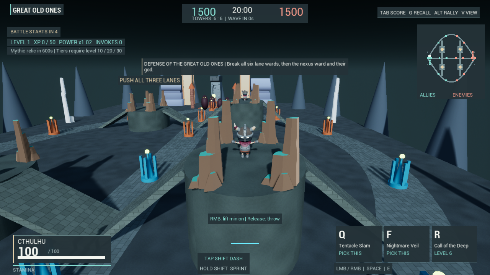
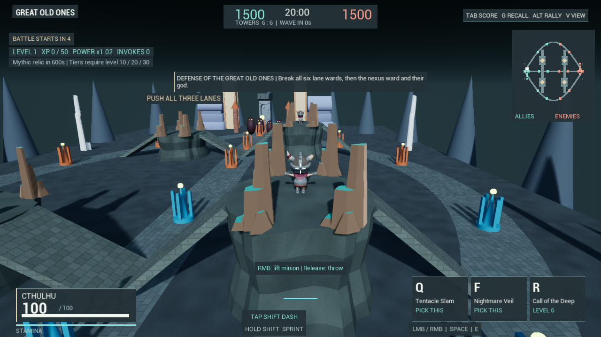

# Jungle cliff geometry

The first jungle platforms were smooth cylinders. The stone-surface pass gave
them shading, but did not address their artificial silhouettes. They now use
four generated, closed triangle meshes with irregular contours, eroded insets,
layered cliff faces and a flat playable crown. Each uses 360 rendered/collision
triangles; the complete set uses 1,440. There is no new model or material asset.

The original camp centres, 25/35-metre heights and eight ramp routes remain.
Broad ramp landing collars retain their contour, while ledges beneath the
existing crown-rock groups preserve support around those features. Left/right
camps mirror their geometry. Higher/lower camps retain their existing encounter
health, damage and XP values; this change does not rebalance monsters.

The visible procedural mesh supplies triangle collision, cooked synchronously
during construction. Production does not retain a hidden cylinder collider.
The native comparison fixture alone creates the old cylinder representation,
then enables collision only for the representation currently shown. Its cylinder
is a recreated baseline in the same new world, not a separate old-build capture.
The minimap now reads procedural as well as static collision components, using
their bounds. Those map rectangles are not precise contour drawings. The
material switch also handles every mesh section. The ordinary minimap component
list uses inline storage to avoid a heap allocation per single-component actor.

The initial conservative contour passed physical checks but still looked too
close to a faceted cylinder. It was revised with stronger side insets and rock
pockets. The near inspection camera was also moved to the west face; images
across those iterations are not matched viewpoints. The final before/after pair
below uses the same paused world and camera.

## Verification

The canonical build and all seven final native Editor checks pass with zero
automation errors: JungleCliffGeometry, JungleCamps, MobaJungleReturns,
MobaLaneClearance, MobaMatch, MatchSurfaces.Moba and MobaLiftTextRendering.

- All 1,440 rendered triangles match direct physical surface traces.
- All 20 sampled plateau positions support the actual 30-metre Cthulhu capsule.
- All 24 physical contour comparisons match between mirrored teams.
- All 12 jungle-to-lane minion return cases complete by physical movement.
- The match fixture walks the full-size player up a high-plateau ramp; lane
  clearance and encounter/leash/reward behavior retain their scoped checks.
- Four dedicated PNGs are exactly 1280x720. Selected near and overview renders
  were viewed. Material comparisons also hash the procedural mesh positions and
  indices to ensure that switching surfaces does not change their geometry.

These do not establish every roster/ramp combination, every landing location,
edge-fight balance, multiplayer behavior or human fun. The newer geometry has
not been run in an independent cooked executable.

## Cost and storage

Four 120-frame windows compare cylinder/cliffs/cliffs/cylinder in one frozen
overview scene. Mean GPU time is 3.217 ms for cylinders and 3.228 ms for cliffs
(+0.011 ms); game-thread means are 9.377 and 9.470 ms. These ordinary 1288x680
Editor windows are distinct from the exact-size PNGs. They are not a live battle,
low-spec, high-resolution or memory benchmark. The comparison retains both
representations for switching; production builds only the procedural one.

The first recorded four-camp construction reports 15.19 ms for the first camp
and 3.09-3.62 ms for the remaining camps, including synchronous generation/cook.
Those timings describe that constructor path on this host, not total map load.
JungleCliffResults.json retains windows, hashes, construction samples, rejected
initial contour and final results. The existing material and imported art are
reused; no model/texture download or new game package is created.

## Paired near view

The cliffs have a more defined layered silhouette, but remain stylized generated
terrain. Flat crowns, regular access ramps, sparse dressing, crude rock props,
background cones and placeholder heroes remain visible. This is an environment
improvement, not finished geological art or Overwatch-level presentation.
