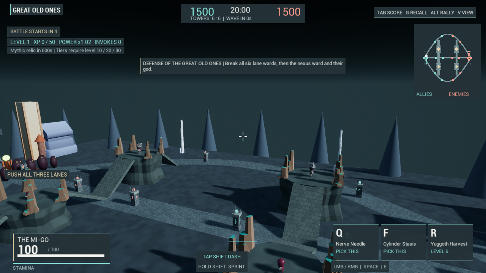
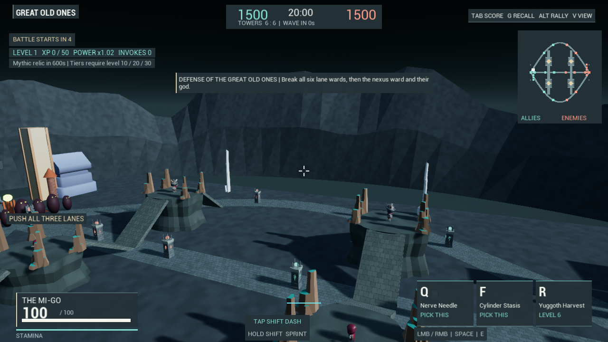
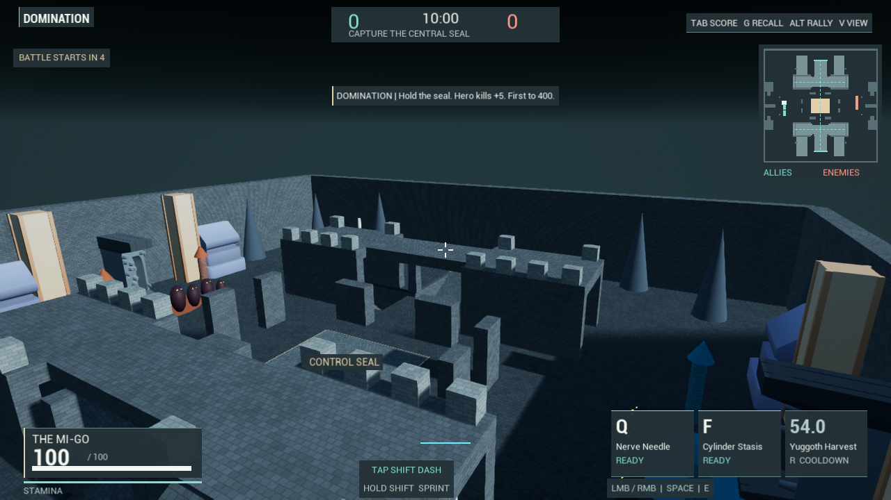
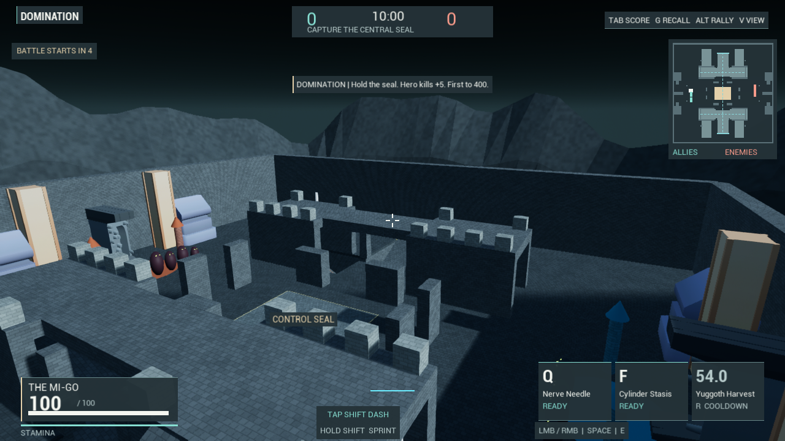

# Arena rock ranges

Both competitive arenas previously ended in twenty-four identical cone props.
The repetition was visible from ordinary play and made each location read as a
primitive test scene. They now share an irregular exterior rock range with
uneven peaks, offset strata and the existing natural-stone material. Geometry
is generated deterministically from source; no model, texture or download is
added. This addresses the horizon, not the unfinished arena art as a whole.

One procedural mesh actor replaces the twenty-four cone actors in production.
It contains five sections and 960 triangles, including the underside. The range
uses existing materials with masonry disabled. Intermediate strata are offset
to interrupt radial repetition. There are still broad, visibly low-detail facets.

The innermost ellipse is 580 by 400 metres in MOBA and 500 by 480 metres in
Domination. Every generated vertex is outside that ellipse, which encloses even
the corners of each playable rectangle. The range does not collide, navigate,
cast shadows or enter the tactical minimap. Lanes, cliffs, ramps, tunnels,
capture rectangle, cover, lighting and combat rules retain their existing state.
These mountains are distant scenery; they are not new explorable terrain.

`cult.Match.Backdrop 0` selects the old cones at arena creation. The editor-only
comparison can create both representations in one paused real match and switch
visibility. Production creates only the selected representation. The fixture's
hidden comparison meshes are not evidence of production memory usage.

## Verification and review

MatchBackdropResults.json records the final canonical Editor build, native
test outcomes, input verification and hashes of the actual rendered images.
Two native fixtures cover Domination and MOBA. They check the actual 960-triangle
geometry, finite/exterior vertex positions, inward/upward front-face normals,
five sections, varied heights, no collision, no shadows, one production mesh
and absence of old cones. Every real arena, hero and objective mesh retains its
transform, collision setting and visibility while the representation changes.

Four exact 1280x720 images per mode use matched spawn and overview poses in one
paused world. Separate match, full-size MOBA lane-clearance and all twelve
jungle return-path checks exercise the real gameplay scene. These checks do not
prove human fun, balance, complete art quality or sustained performance.

The first rendered review exposed reversed face orientation; reversing the
triangle winding and checking inner face normals corrected it. The first two
fixture runs also reported transform failures. Detailed diagnostics identified
the fixture's deliberately moved CameraProxyMeshComponent, rather than game
geometry. Only that test-owned camera is excluded from the snapshot; real
player/arena/objective checks remain. Failed evidence is recorded in the report.

All 425 backed-up Content files remain byte-identical. The 64 untracked runtime
animation/definition copies are byte-identical to their original source files;
they are build staging inputs and are not added to this backup. No new authored
Content, packaged game, archive, texture or downloaded model is generated.

## Remaining production gaps

This is a coarse distant silhouette improvement. It does not replace authored
geological landmarks, weathering, foliage, sky art or environmental storytelling.
Temple columns and roofs, large plain walls and slabs, placeholder entity bodies,
animation, combat VFX and the overall map composition remain conspicuously rough.
The reference games have substantially more cohesive art direction, animation,
audio, authored encounter spaces and human-tested battle pacing.

No frame-time improvement, low-spec performance certification or memory savings
is claimed. No new standalone cook/package was produced in this pass. Readability
from every camera, long-session match behavior, multiplayer, human balance and
fun still require broader work. The complete production objective remains open.
