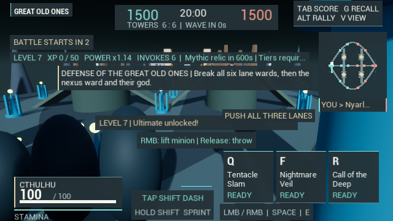

# Objective and elimination readability

HeroDied previously called Announce for every credited hero kill. The same
single notice also carries captures, overtime, rallies and defense messages.
Consequently a kill could immediately erase the objective announcement during
the fight in which the player most needed it. Long competitive copy also used
fixed single-line positions, allowing text to run into the tactical map or
outside narrow viewports. These were concrete information-hierarchy problems,
not evidence of professional presentation or satisfying combat.

Eliminations now have a separate bounded list: four recent entries, each lasting
six active seconds. The HUD shows up to three rows when space permits and one
on short displays; if necessary that row uses the map's legend area. Local
involvement is gold, YOU identifies the local vessel, and the two edge marks
identify attacker/victim factions. Long names are abbreviated to measured
widths; the scoreboard retains the full recorded match statistics. Uncredited
deaths show ENVIRONMENT. Repeated death callbacks cannot add kills or events.
The environmental source uses a neutral edge marker rather than an enemy mark.

Kills retain their original scoring, XP, assists and respawn rules. They no
longer replace objective announcements. Pause preserves both event lifetimes
and objective copy. The objective channel still allows subsequent objective
events to replace previous ones; this change is not a complete alert-priority
or history system.

Competitive hints and announcements wrap using the actual font metrics, in a
column clear of the tactical map. Progress/relic details use a compact row on
short displays, with ellipsis if needed. The map and feed reserve the ability,
RMB and player-notice area already measured by the combat HUD. This supports
the existing dark theme without adding textures or font downloads.
Projected objective labels also clamp inside the viewport's play area instead
of running off its right edge. Backplates fit their measured copy, including
the progress/relic rows that otherwise lost contrast against bright geometry.

Verification combines the real Domination damage/death path with two native
rendering fixtures. The latter deliberately invoke the normal death dispatcher
five times to test bounded events, an environmental death, duplicate protection,
pause, expiry and actual glyph bounds. That seeded sequence is not a physical
combat simulation. Dedicated render targets check PNG dimensions at 640x360,
1280x720 and 1920x720, alongside the existing ordinary HUD and input regressions.
MatchEventsResults.json records the results, log hashes and reviewed captures.

The first seven-test batch passed both physical match regressions and input,
but DominationEventReadability failed an inherited assertion requiring the
MOBA-only Cthulhu minion instruction in Domination. The mode guard was corrected.
After the final HUD-only contrast/bounds/spacing refinements, all four focused
UI tests passed with zero automation errors and twelve exact-size PNGs.
The match gameplay source was unchanged by those final visual refinements.
Selected final small/normal/wide frames were viewed. Compact metadata and long
names still abbreviate, and the underlying vessels/environment remain blockout.

The game still needs substantial work in hero/environment art, crowd visibility,
movement/combat animation, tactical AI, sustained frame rate, balance and human
match evaluation. This change improves readable match information; it does not
establish Overwatch-level refinement or Paladins-level fun. The newer edits have
Editor evidence only, with no new independent executable or package created.
