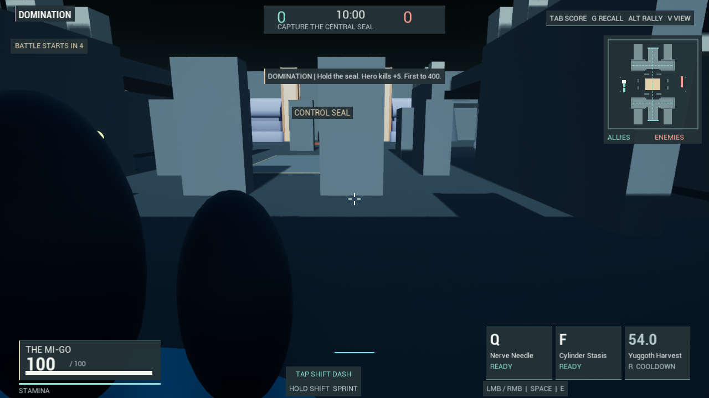
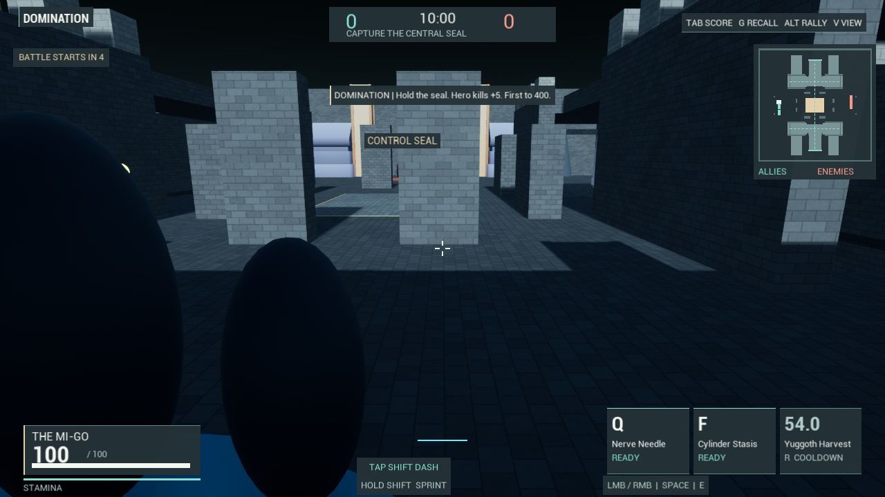

# Competitive arena surfaces

The competitive renders exposed broad flat-tint walls, floors and ramps. Their
plain surfaces reinforced the primitive geometry and provided little sense of
scale. This pass adds an original world-aligned stone material to tagged arena
surfaces. It does not turn the blockout into finished castle or geological art.

M_MatchStone uses world-coordinate masonry, staggered joints, modest
block/weather variation, roughness variation and a surface-gradient normal.
There are no texture downloads or new texture samples. World projection keeps
stretched collision blocks and adjacent floor tiles at a consistent pattern
scale. MOBA lanes remain paved; surrounding ground and jungle mesas use the
rougher non-masonry profile. The initial all-paved MOBA ground was rejected
during visual review and corrected before the final regression run.

Only materials on explicitly tagged surfaces change. Imported art, hero/minion
materials, collision meshes, positions and gameplay rules retain their existing
inputs. The native paired comparison verifies the same player transform, actor
count, arena meshes, visibility and collision before/after. It checks a compiled
shader map with no material compile errors, rather than accepting a fallback.
145 existing World assets and M_ArenaSurface were byte-checked against checkpoint
47026f2992473805ae1be95936e2823578a3fa8c with zero differences.

Both modes use one frozen preparation scene, two actual cameras and four
dedicated 1280x720 PNGs each. Selected paired spawn and overview frames were
viewed. The ordinary live Domination combat-signal frame was also viewed; it
still shows placeholder vessels, while the objective border and attack volume
remain visible against the new floor. That is a limited visual observation,
not a human readability or fun evaluation.

The final canonical build and all nine native Editor checks passed: four camera
cases, both surface comparisons, DominationMatch, MobaMatch and MobaLaneClearance.
The first link attempt exposed the shader-verification test's RHI dependency;
the Editor-only dependency is now explicit. The material recipe and original
HLSL are in Tools/BuildMatchStone.py and Tools/MatchStone.hlsl. To rebuild an
existing generated material, explicitly pass -CultRebuildMatchStone; the tool
preserves its previous small asset in Saved/Backups. Imported materials are
never rebuilt by this tool. cult.Match.Stone selects the surface treatment when
building a new arena; the native comparison calls Apply for its current world.

## Measured render cost

Four 120-frame windows per mode use A-B-B-A (flat/stone/stone/flat), after
settling. The scene and spawn camera are frozen; there is no live battle load.
These timings come from the ordinary 1288x680 Editor backbuffer, separately
from the exact-size review images. CSV footer metadata is excluded and the two
new arena counters are classified as counts, not milliseconds.

| Mode | Flat GPU mean | Stone GPU mean | Difference |
| --- | ---: | ---: | ---: |
| Domination | 3.506 ms | 3.533 ms | +0.026 ms |
| MOBA | 3.703 ms | 3.716 ms | +0.013 ms |

This one-host frozen-view sample shows a small measured GPU difference. It does
not establish low-spec performance, high-resolution cost, live combat FPS or
statistical equivalence. MatchSurfaceResults.json retains windows, counts,
image/log hashes, rejected initial presentation and source/asset evidence.

## Paired gameplay view

These are captures from the same paused Domination world and camera.

The regular masonry helps surfaces read as constructed stone, but the repeated
primitive silhouettes, smooth jungle mesa shapes, sparse ground dressing,
placeholder heroes and crude imported-art joins remain conspicuous. Final art,
landmark composition, biome variety, animation, accessibility, sustained battle
performance and human playtests remain necessary. No new standalone package
was created. The new material asset is about 11 KB; only source, that small
asset, evidence and the two review images are backed up by this pass.
