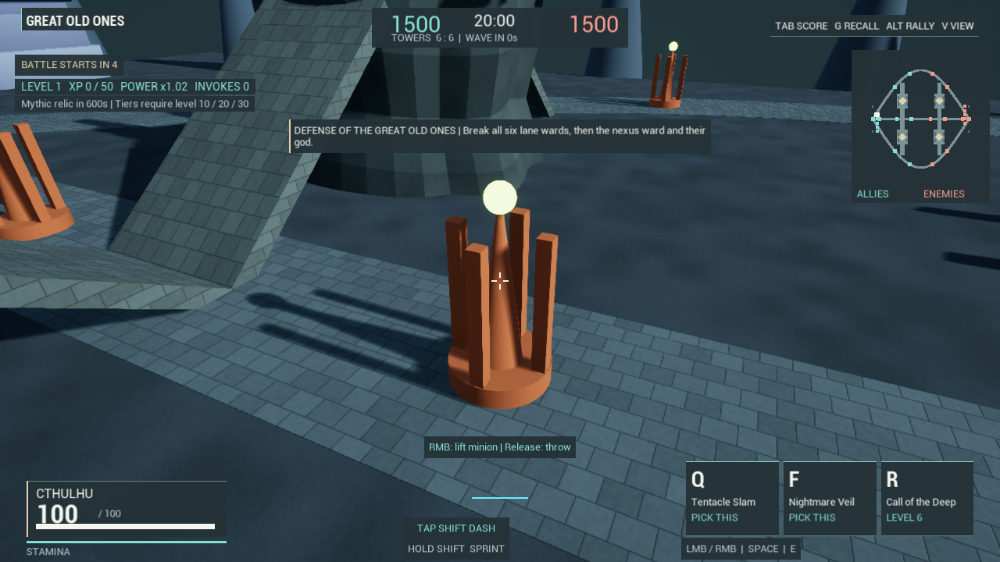
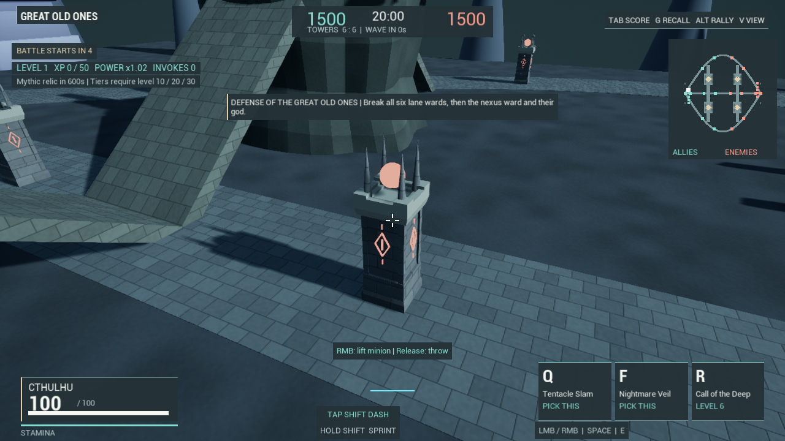
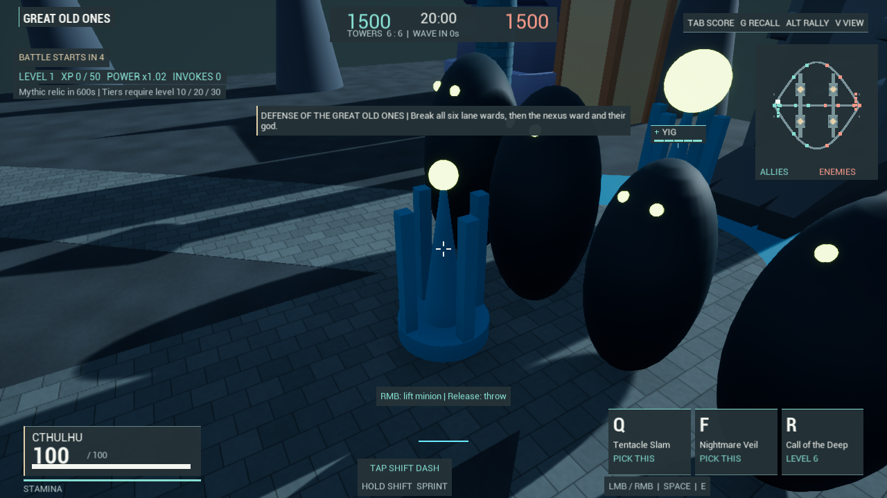
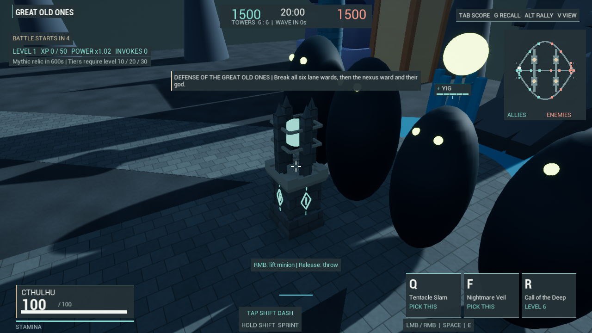

# Stone ward architecture

The original lane towers and nexus wards shared a cone, four plain posts and
a bright ball, painted almost entirely blue or orange. That silhouette read
as a blockout prop. Lane wards now use a masonry shaft, crenellated crown,
four stone tines and faction sigils. Nexus wards use a broader plinth and a
caged emitter. Dark stone supplies the body; faction color is concentrated in
the emitter and markings. The Great Old One objective retains its placeholder
art, pending a proper entity model.

The two meshes reuse the repository's Kenney CC0 castle base, middle section
and crown, plus small original arrangements of engine primitives and sigils.
See assets/world/LICENSES.md. No model or texture download is involved.
BuildWardArchitecture.py merges the arrangements into one mesh per objective,
using three existing material assets. Production creates one mesh component
instead of seven. Twelve lane wards and two nexus wards therefore use fourteen
visible mesh components instead of ninety-eight. Each lane mesh has 3,692
triangles; each nexus mesh has 4,380. This is not a reduction in triangle count.

Gameplay still uses the retained solid capsule. Health, range, damage,
protection order, firing cooldown, projectile speed, placement and capsule
dimensions are unchanged. The visible emitter is centred on the original
projectile origin. A stored muzzle socket and the actual emitter vertices are
checked against real native firing events. Destroyed assembled wards extinguish
their own signal material before leaving the same assembled mesh as remains.
Other wards' independent glow materials retain their live values.

## Rebuild and preservation

Run the canonical full Editor with `-ExecutePythonScript=.../Tools/BuildWardArchitecture.py`;
the mesh-merge subsystem is unavailable in the Python commandlet. The script
closes a CLI-launched Editor when it finishes. It creates an unsaved blank
working world and saves only its two mesh assets under `/Game/CultUlhu/World/Wards`.
It does not save authored maps or modify the original kit meshes/materials.
The crown is imported in memory without duplicate materials or textures. If
its small GLB is absent, only that source is decoded from its repository .b64.

Ownership metadata prevents replacing a user asset at either output path.
An older tool-owned asset is backed up byte-for-byte in Saved/Reports before
replacement. Prior partial outputs and intermediate generated versions were
preserved there. The existing World cook directory includes the two outputs;
a new standalone executable has not been produced in this phase.

Several build failures were corrected before acceptance: commandlet subsystem
availability, Unreal's automatic `SM_` naming, socket editor-property access,
and positional rotator argument ordering. The last one produced an invalid
nexus footprint and was caught by inspecting generated bounds; explicit axes
and footprint/height guards correct it. A test pointer-type compilation error
was also corrected. An earlier attempted test launch matched zero tests on the
old binary and is not counted as verification.

## Review and measurement scope

WardArchitectureResults.json records final checks and scoped timing samples.
The native comparison uses fourteen real objectives in one paused MOBA world.
It keeps actor transforms, combat values and collision fixed while toggling
only the old/new visible representation. Six exact 1280x720 captures show lane,
nexus and overview pairs. The nexus review camera was changed for both sides
of the pair after teammates obscured the first view. Comparison-only hidden
components remain in that fixture; production does not retain the old parts.

Four 120-frame A-B-B-A windows measure the same frozen overview. They do not
measure live battle FPS, low-spec hardware, memory savings, package load time
or input latency. The production one-component construction is separately
checked through a fresh ward and its actual corpse. The native fixture also
checks that all three material sections, the glowing geometry, projectile
muzzle, remaining mesh and death glow behave as intended.

The matched review pairs below use the same new build, world and camera for
each before/after view; the legacy display is recreated with the comparison
switch. These are objective-art comparisons, not separate old-build captures.

Final verification: canonical Editor build succeeded in 16.97 seconds; all six
native checks passed with zero automation errors. An asset-registry inspection
confirms the two meshes depend on the three persistent game materials and the
engine navigation script, with no transient crown package. All 423 pre-existing
Content files are byte-identical; character inputs have no substantive changes.
The two new mesh assets total 192,664 bytes. Frozen paired GPU means are 3.344
ms legacy and 3.332 ms stone; that tiny difference is not evidence of a meaningful
performance improvement. Saved build outputs and caches are excluded from backup.

## Remaining gaps

The new forms are still modular, low-detail architecture. Temple framing,
background cones, sparse biome dressing, placeholder entity bodies and their
animation remain conspicuous in the overview. The gameplay capsule is still a
coarse approximation; decorative gaps are not per-triangle collision. There
are no progressive fracture states or collapse animations. Small local visual
improvements and automated checks do not establish Overwatch-level refinement
or Onslaught-level fun. Human battle readability, balance and sustained
performance remain unmeasured; the complete production goal stays open.
